# CLIMORA — Backend & Database Architecture (Phase 0 proposal)

> *Plan the heat out of the workday.*
>
> **Status:** PROPOSAL, awaiting project-owner approval. Nothing in this document is implemented yet.
> **Date:** 2026-11-11 · **Scope:** backend + PostgreSQL only (no frontend).

---

## 0. Environment inspection (facts, as found on 2026-11-11)

| Item | Finding | Consequence |
|---|---|---|
| Repository | `medhachoudhari/SetuCare`, branch `claude/zen-rubin-595zaz`. Contains an **unrelated** project: `backend/` = *SetuCare* (healthcare referral-closure API, FastAPI, integer PKs, SQLite fallback, bcrypt, ~4.4k lines). | CLIMORA must not be mixed into SetuCare's code. Proposed: CLIMORA lives in `climora/` (this doc is at `climora/docs/`). **Decision D1** below. |
| Python | 3.13.18 | Target 3.13 as requested. |
| PostgreSQL | 16 installed (cluster `16/main`), was stopped; starts fine with `pg_ctlcluster 16 main start`. | Tests can run against a real PostgreSQL (not SQLite). |
| Docker | Binary present, daemon not running. | No testcontainers; tests use a local PG test database. |
| PyPI | Reachable. `ortools 9.15`, `psycopg 3.3`, `argon2-cffi 25.1`, `fastapi`, `sqlalchemy` resolve for 3.13. | Stack is installable. Exact pins chosen in M1 after a compatibility install. |
| Open-Meteo | `api.open-meteo.com` **blocked** by this environment's network proxy (HTTP 403 on CONNECT). | Weather client will be built and tested against clearly-labelled mocked HTTP fixtures. Live verification needs the host allowed in the cloud environment (**Decision D6**). |
| Official sources (doh.gov.ae etc.) | Not reachable directly from the container. | Scientific verification must be done by the project owner / a human against the primary PDFs (see §8). |

---

## 1. Understanding of CLIMORA

CLIMORA is an **operational decision-support system** for organisations with outdoor workforces in hot climates
(initial jurisdiction: UAE / Abu Dhabi). It converts *"tomorrow will be hot"* into *"here is a safe, rule-compliant
plan for who does what, when, with which breaks — and proof that the protective actions actually happened."*

The core loop:

```
 Forecast / measurement ─► Heat-risk engine (TWL, versioned rules) ─► hourly heat zones per worksite
                                                                          │
 Worker readiness (acclimatisation, absences, clearances) ───────────────┤
                                                                          ▼
 Tasks (intensity, duration, crew size) ─────────────► CP-SAT scheduler (hard safety constraints)
                                                                          │
                                                       independent validator ─► supervisor approval
                                                                          │
                                                 protective actions (breaks, hydration, rotations)
                                                                          │
                     worker app ack/confirm (offline-capable) ─► deadline monitor ─► escalation
                                                                          │
                                                        audit + analytics + (later) AI explanations
```

Guiding principles, which drive every design choice below:

1. **Deterministic safety.** Every safety-relevant decision (zone, allowance, schedule feasibility, escalation) is
   made by pure, versioned, unit-tested Python. AI never sits on that path.
2. **No invented science.** Thresholds and rules live in versioned *rule sets* with source citations and a
   verification status. Unverified rules can be computed and displayed, but can never *authorise* real work.
3. **Conservatism.** Forecast-derived values are labelled `ESTIMATED`; uncertainty is propagated and the
   classification uses the more dangerous bound; a direct measurement or official restriction that is stricter
   always wins.
4. **Evidence over assumption.** A notification sent ≠ an action done. Only an explicit confirmation by an
   accountable person changes an action to `CONFIRMED`.
5. **Privacy by construction.** Health-adjacent data is physically separated, encrypted, access-logged and
   invisible to supervisors and management except as k-anonymised aggregates.
6. **Tenant isolation.** Every business row belongs to exactly one organisation and the database enforces that
   cross-organisation references are impossible.

---

## 2. Backend architecture

### 2.1 Runtime components

| Component | Process | Responsibility |
|---|---|---|
| **API** | `uvicorn app.main:app` (stateless, horizontally scalable) | HTTP, auth, validation, orchestration of services. |
| **Worker** | `python -m app.worker` (separate process) | Scheduled & queued jobs: forecast refresh, heat-risk recompute, deadline/escalation sweep, notification delivery (outbox), daily readiness roll-forward, analytics aggregation. |
| **PostgreSQL 16** | — | System of record **and** job queue (`jobs` table + `SELECT … FOR UPDATE SKIP LOCKED`). No Redis in early milestones. |
| **External** | — | Open-Meteo (weather), later: push/SMS providers, LLM provider (M11). |

Why a separate worker and a Postgres-backed queue: escalation must keep running when no HTTP traffic arrives,
must not double-fire when the API is scaled to N replicas, and must survive restarts. Postgres row locks give
exactly-once *claiming*; idempotency keys give exactly-once *effects*. Adding Redis/Celery is deferred until load
justifies it.

### 2.2 Layering

```
api (routers, deps)  →  services (use-cases, transactions, authorisation)  →  repositories (org-scoped queries)
                              │                                                       │
                              ├──► domain (pure: heat_risk, acclimatisation, scheduling, actions state machine)
                              └──► integrations (weather providers, notifications, llm)
```

* **Routers** only translate HTTP ⇄ schemas and call one service method.
* **Services** own the unit of work (one transaction per request), permission checks and audit writes.
* **Repositories** are thin and always take an `OrgContext`; there is no repository method that can query
  across organisations except explicitly-named system jobs.
* **Domain** packages import nothing from FastAPI or SQLAlchemy. They take plain dataclasses/Pydantic models in
  and return results + provenance out. This is what makes the safety logic exhaustively testable.

### 2.3 Concurrency & transactions

* Sync SQLAlchemy 2.x sessions with psycopg 3 run in FastAPI's threadpool. (Async adds complexity without a
  measured need; CP-SAT is CPU-bound and runs in the worker anyway.) — **Decision D4**.
* Optimistic concurrency (`version` integer column) on mutable aggregates edited by humans: worker, worksite,
  task, schedule, protective action. Stale `If-Match`/`version` → `409 conflict`.
* State transitions use `UPDATE … WHERE status = :expected` so racing transitions cannot both succeed.

---

## 3. PostgreSQL entity-relationship design

### 3.1 Refinements to the proposed entity list

| Change | Reason |
|---|---|
| `WeatherForecast` → **`weather_forecast_runs`** + **`weather_forecast_hours`** | One fetch produces many hourly values; run-level provenance (provider, model, issued/fetched time) shouldn't repeat per hour. |
| `SafetyRuleSet` + **`rule_sources`** | Citations (document, version, section, table, verification status) need their own rows; a rule set cites many sources. |
| + **`refresh_tokens`** | Rotating refresh tokens with reuse detection. |
| + **`crews`** / **`crew_members`** | Protective actions and tasks target "crews"; avoids ad-hoc arrays of worker IDs. |
| `Task` + **`task_requirements`** | Crew size, skills, intensity class per task, kept relational. |
| `Schedule` + **`schedule_items`** (+ `schedule_runs`) | A schedule is a header; items are the (worker, task, start, end) rows; runs keep solver input/outcome for alternatives & explanations. |
| + **`worker_return_to_work_clearances`** | Human (occupational-health) decisions are *recorded*, never computed. |
| + **`escalation_policies`** | Configurable grace periods / levels / recipients per org or worksite. |
| `Notification` + **`notification_deliveries`** | Outbox pattern; one notification, many delivery attempts/channels. |
| + **`sensitive_access_log`** | Every read of a safety report is logged separately from the general audit log. |
| + **`sync_receipts`** | Idempotency for offline-queued mobile operations. |
| + **`jobs`** | Postgres job queue for the worker. |
| `ProtectiveActionConfirmation` stays, plus **`protective_action_events`** | Full state-transition history (PLANNED→SENT→ACK→CONFIRMED / MISSED / CANCELLED). |
| `WeatherObservation` vs `EnvironmentalMeasurement` kept separate | Observation = provider/station reanalysis data (accuracy analytics). Measurement = on-site instrument readings (Tdb, Tnwb, Tg, wind) that can *override* estimates. Different trust levels. |

### 3.2 ER diagram (core relationships)

```mermaid
erDiagram
  organisations ||--o{ users : has
  organisations ||--o{ worksites : has
  organisations ||--o{ workers : employs
  users ||--o{ user_roles : granted
  roles ||--o{ user_roles : ""
  worksites ||--o{ user_roles : "optional scope"
  users |o--o| workers : "worker login (optional)"
  workers ||--o{ worker_worksite_assignments : ""
  worksites ||--o{ worker_worksite_assignments : ""
  worksites ||--o{ crews : ""
  crews ||--o{ crew_members : ""
  workers ||--o{ crew_members : ""

  worksites ||--o{ weather_forecast_runs : "grid point"
  weather_forecast_runs ||--o{ weather_forecast_hours : ""
  worksites ||--o{ weather_observations : ""
  worksites ||--o{ environmental_measurements : ""
  safety_rule_sets ||--o{ rule_sources : cites
  safety_rule_sets ||--o{ heat_risk_calculations : "applied"
  weather_forecast_hours ||--o{ heat_risk_calculations : "input (estimated)"
  environmental_measurements ||--o{ heat_risk_calculations : "input (measured)"

  workers ||--|| worker_acclimatisation_records : ""
  workers ||--o{ worker_absences : ""
  workers ||--o{ worker_return_to_work_clearances : ""
  workers ||--o{ worker_readiness_assessments : "daily"
  safety_rule_sets ||--o{ worker_readiness_assessments : "applied"

  worksites ||--o{ tasks : ""
  tasks ||--o{ task_requirements : ""
  worksites ||--o{ schedules : ""
  schedules ||--o{ schedule_runs : "solver attempts"
  schedules ||--o{ schedule_items : ""
  schedule_items }o--|| tasks : ""
  schedule_items }o--|| workers : ""
  schedules ||--o{ schedule_approvals : ""
  tasks ||--o{ task_assignments : "approved"

  schedules ||--o{ protective_actions : generates
  worksites ||--o{ protective_actions : ""
  protective_actions ||--o{ protective_action_assignments : targets
  protective_actions ||--o{ protective_action_confirmations : ""
  protective_actions ||--o{ protective_action_events : history
  protective_actions ||--o{ escalations : ""
  escalation_policies ||--o{ escalations : ""

  workers ||--o{ worker_safety_reports : submits
  worker_safety_reports ||--o{ sensitive_access_log : ""
  notifications ||--o{ notification_deliveries : ""
  worksites ||--o{ historical_risk_aggregates : ""
  organisations ||--o{ audit_logs : ""
```



### 3.3 Cross-cutting schema conventions

* **PK:** `id UUID NOT NULL DEFAULT gen_random_uuid()` (PG 13+ built-in). Application may also supply IDs
  (needed for offline-created records). UUIDv7 considered for index locality — **Decision D5**.
* **Tenant column:** every tenant-owned table has `organisation_id UUID NOT NULL`.
* **Same-tenant FK enforcement:** each tenant table has `UNIQUE (organisation_id, id)`; child tables reference
  parents with **composite FKs** `(organisation_id, parent_id) → parent(organisation_id, id)`. This makes it
  *physically impossible* to, e.g., assign an Org-A worker to an Org-B worksite, even with an application bug.
* **Row-Level Security:** policies `organisation_id = current_setting('app.org_id')::uuid` prepared as a second
  line of defence, enabled in M12 after measuring overhead (**Decision D7**).
* **Timestamps:** `TIMESTAMPTZ`, stored UTC; `created_at`, `updated_at` (trigger-maintained). Local-time logic
  (midday ban, shifts) uses the worksite's IANA `timezone`.
* **Soft lifecycle:** business entities use `status` / `is_active` + `deactivated_at`, never hard delete.
  Append-only tables (audit, events, calculations, confirmations) are never updated or deleted by the app role.
* **Enums:** `VARCHAR` + `CHECK (col IN (...))` rather than native PG enums (cheaper to evolve in migrations).
* **Units in column names** where physical: `air_temp_c`, `wind_speed_ms`, `pressure_hpa`, `twl_wm2`,
  `solar_radiation_wm2`.
* **JSONB only where justified:** rule-set content (validated against a Pydantic schema per `schema_version`),
  solver diagnostics, calculation provenance, audit diffs, raw provider payload digests.
* **Optimistic locking:** `version INT NOT NULL DEFAULT 1` on human-edited aggregates.

### 3.4 Table catalogue

Abbreviations: **PK** primary key, **FK** foreign key, **U** unique, **CK** check, **IX** index,
`org` = `organisation_id` (composite-FK pattern implied for every tenant FK).

#### Identity & access

**organisations** — tenant root.
`id PK, name VARCHAR(200) NOT NULL, slug VARCHAR(64) U, legal_name, country_code CHAR(2) CK ISO-3166,
default_timezone VARCHAR(64), default_rule_set_jurisdiction VARCHAR(32), status CK(active|suspended|closed),
created_at, updated_at, version`. Retention: life of contract + legal retention.

**roles** — seeded reference table (not tenant-owned).
`code PK VARCHAR(32)` ∈ `org_admin, hse_officer, supervisor, occupational_health, management_readonly, worker`;
`description`. Permissions are mapped in code (`core/permissions.py`) and tested as a matrix; roles in DB allow
FK integrity and reporting.

**users** — people who log in.
`id PK, org FK, email CITEXT NULL, phone VARCHAR(32) NULL, full_name, password_hash TEXT (argon2id),
worker_id UUID NULL FK workers U, preferred_language VARCHAR(10), is_active BOOL, last_login_at,
password_changed_at, failed_login_count, locked_until, created_at, updated_at, version`.
U `(organisation_id, email)` where email not null; CK `email IS NOT NULL OR worker_id IS NOT NULL`.
Retention: deactivate, never delete while referenced by audit.

**user_roles** — role grants, optionally scoped to a worksite (supervisors are typically site-scoped).
`id PK, org, user_id FK, role_code FK roles, worksite_id FK NULL, granted_by FK users, granted_at, revoked_at`.
U partial `(user_id, role_code, coalesce(worksite_id,'0…'))` where `revoked_at IS NULL`. IX `(user_id)`.

**refresh_tokens** — `id PK, user_id FK, family_id UUID, token_hash BYTEA U (SHA-256), issued_at, expires_at,
rotated_at, revoked_at, revoke_reason, user_agent_hash, ip_hash`. IX `(user_id)`, `(family_id)`.
Retention: purge 30 days after expiry.

**audit_logs** — append-only.
`id PK, org NULL (system events), occurred_at, actor_user_id NULL, actor_type CK(user|system|worker_device),
action VARCHAR(64), entity_type, entity_id UUID, request_id UUID, ip_hash, changes JSONB (redacted diff),
prev_hash BYTEA, row_hash BYTEA`. IX `(organisation_id, occurred_at DESC)`, `(entity_type, entity_id)`.
Hash-chained per organisation for tamper evidence. App DB role has INSERT/SELECT only. **Never contains health
report content.** Retention: configurable, default 7 years (OSH record-keeping — to verify, **D10**).

#### Workforce & sites

**worksites** — `id PK, org, code VARCHAR(32), name, country_code, region VARCHAR(64), timezone VARCHAR(64),
latitude NUMERIC(8,6) CK[-90,90], longitude NUMERIC(9,6) CK[-180,180], elevation_m NUMERIC NULL,
shade_availability CK(none|partial|full), work_categories TEXT[] (CK against allowed list),
rule_set_jurisdiction VARCHAR(32), weather_provider_config JSONB NULL, station_identifier NULL,
status CK(active|inactive), created_at, updated_at, version`. U `(organisation_id, code)`.
IX `(organisation_id, status)`. Optional PostGIS deferred (**D8**).

**workers** — minimum necessary data only (no medical data here).
`id PK, org, worker_code VARCHAR(32), full_name, employee_number NULL, employer_name NULL (subcontractors),
job_title, trade VARCHAR(64), experience_category CK(new|experienced), preferred_language VARCHAR(10),
employment_status CK(active|on_leave|suspended|terminated), employment_start_date DATE,
employment_end_date DATE NULL CK(>= start), phone NULL, created_at, updated_at, deactivated_at, version`.
U `(organisation_id, worker_code)`, U partial `(organisation_id, employee_number)`.
IX `(organisation_id, employment_status)`, trigram IX on `full_name` for search (pg_trgm).
Worker codes: `<ORGPREFIX>-<6 chars Crockford base32>` generated server-side, retry on collision.
Retention: deactivate; anonymise PII N years after termination (**D10**).

**worker_worksite_assignments** — `id PK, org, worker_id, worksite_id, valid_from DATE, valid_to DATE NULL,
is_primary BOOL, assigned_by`. EXCLUDE constraint (btree_gist) preventing overlapping *primary* assignments
per worker. IX `(worksite_id, valid_from)`.

**crews**, **crew_members** — `crews(id, org, worksite_id, name, supervisor_user_id, is_active)`;
`crew_members(crew_id, worker_id, valid_from, valid_to)` PK `(crew_id, worker_id, valid_from)`.

#### Weather & environment

**weather_forecast_runs** — one provider fetch for one location.
`id PK, org, worksite_id, provider VARCHAR(32), provider_model VARCHAR(64), latitude, longitude,
requested_at, fetched_at, provider_issued_at NULL, forecast_start, forecast_end, status CK(ok|partial|failed),
missing_fields TEXT[], http_status, payload_sha256, attribution TEXT, licence_tier CK(non_commercial|commercial)`.
IX `(worksite_id, fetched_at DESC)`. Retention: hourly rows 2 years hot, then aggregate & archive.

**weather_forecast_hours** — `id PK, run_id FK, org, worksite_id, valid_time TIMESTAMPTZ, air_temp_c,
relative_humidity_pct CK[0,100], dew_point_c, wind_speed_10m_ms CK>=0, surface_pressure_hpa,
shortwave_radiation_wm2 CK>=0, direct_radiation_wm2, diffuse_radiation_wm2, cloud_cover_pct CK[0,100],
is_day BOOL, quality_flags TEXT[]`. U `(run_id, valid_time)`. IX `(worksite_id, valid_time)`.

**weather_observations** — same physical columns + `source CK(provider_archive|station)`, `observed_at`.
U `(worksite_id, source, observed_at)`. Used for forecast-accuracy analytics.

**environmental_measurements** — on-site instruments.
`id PK, org, worksite_id, measured_at, instrument_id, measured_by_user_id NULL, dry_bulb_c,
natural_wet_bulb_c NULL, globe_temp_c NULL, globe_diameter_mm NULL, wind_speed_ms, pressure_hpa NULL,
relative_humidity_pct NULL, measured_twl_wm2 NULL, entry_method CK(device|manual), calibration_ref NULL`.
IX `(worksite_id, measured_at DESC)`.

#### Safety science

**safety_rule_sets** — `id PK, org NULL (NULL = platform-wide official set; org rows = stricter org overrides),
jurisdiction VARCHAR(32), code VARCHAR(64), version VARCHAR(32), schema_version INT, title,
verification_status CK(draft|unverified|verified|superseded|withdrawn), effective_from DATE,
effective_to DATE NULL, content JSONB, content_sha256, verified_by_user_id NULL, verified_at NULL,
created_at`. U `(jurisdiction, code, version)`. CK `verification_status <> 'verified' OR verified_by_user_id
IS NOT NULL`. Rows are immutable once not `draft` (trigger). Org overrides may only be *stricter* — enforced by
the domain validator that compares to the parent set.

**rule_sources** — `id PK, rule_set_id FK, rule_key VARCHAR(128)` (e.g. `twl.zones`, `midday_break.window`),
`document_title, issuing_body, document_version, publication_date, section_ref, table_ref, url, units,
boundary_notes, verification_status, verified_by, verified_at, notes`.

**heat_risk_calculations** — append-only, one per (worksite, valid_time, input, rule set, engine version).
`id PK, org, worksite_id, valid_time, basis CK(estimated_forecast|measured|observed),
forecast_hour_id NULL FK, measurement_id NULL FK, CK exactly one input reference matches basis,
rule_set_id FK, engine_version VARCHAR(32), method_versions JSONB (psychrometrics, globe model, wind
adjustment, TWL), inputs JSONB (all derived intermediates with units), twl_wm2, twl_lower_wm2, twl_upper_wm2,
zone_code VARCHAR(32), zone_code_conservative VARCHAR(32), is_authoritative BOOL, non_authoritative_reasons
TEXT[], computed_at`. IX `(worksite_id, valid_time, computed_at DESC)`.
`is_authoritative = false` whenever basis is estimated **or** rule set not `verified`.

#### Readiness

**worker_acclimatisation_records** — current state (1:1 with worker), updated only by the readiness service.
`worker_id PK/FK, org, status CK(not_started|acclimatising|acclimatised|re_acclimatising|suspended),
programme_start_date DATE NULL, days_completed INT CK>=0, last_heat_exposure_date DATE NULL,
rule_set_id FK, updated_at, version`.

**worker_absences** — `id PK, org, worker_id, start_date, end_date NULL CK(>= start),
reason_category CK(leave|travel|illness|injury|other)` — **category only, no diagnosis text** —
`recorded_by, created_at`. EXCLUDE overlapping absences per worker.

**worker_return_to_work_clearances** — recorded human decisions.
`id PK, org, worker_id, absence_id NULL, decided_by_user_id (must hold occupational_health),
decision CK(cleared|cleared_with_restrictions|not_cleared), restriction_max_workload_class NULL,
valid_from, valid_to NULL, created_at`. No clinical notes stored here.

**worker_readiness_assessments** — daily, append-only, reproducible.
`id PK, org, worker_id, assessment_date DATE, rule_set_id, engine_version, acclimatisation_status,
acclimatisation_day INT NULL, allowed_workload_class VARCHAR(32) NULL, readiness CK(ready|restricted|
not_ready|requires_human_review), reasons JSONB, inputs_digest, computed_at`.
U `(worker_id, assessment_date, rule_set_id, engine_version)`.

#### Work & scheduling

**tasks** — `id PK, org, worksite_id, code, title, description, work_category, intensity_class VARCHAR(32)
(rule-set-defined, e.g. light/moderate/heavy), metabolic_rate_wm2 NULL, duration_minutes CK>0,
divisible BOOL, min_segment_minutes NULL, earliest_start, latest_end CK(> earliest_start),
requires_direct_sun BOOL, exempt_activity_code NULL (e.g. continuous concrete pour — must map to a verified
rule-set exemption), priority INT, status CK(draft|ready|scheduled|in_progress|done|cancelled),
created_by, created_at, updated_at, version`. IX `(worksite_id, earliest_start)`.

**task_requirements** — `id PK, task_id, crew_size INT CK>0, required_trade NULL, min_experience
CK(any|experienced)`.

**schedules** — `id PK, org, worksite_id, schedule_date DATE, status CK(draft|proposed|infeasible|
approved|superseded|cancelled), selected_run_id NULL, rule_set_id, created_by, created_at, version`.
U partial `(worksite_id, schedule_date)` where status = 'approved'.

**schedule_runs** — solver attempts / alternatives.
`id PK, schedule_id, objective_profile VARCHAR(32), inputs_digest, inputs JSONB (snapshot of zones,
readiness, tasks), solver_status CK(optimal|feasible|infeasible|model_invalid|unknown|timeout),
solve_time_ms, objective_value, diagnostics JSONB (infeasibility explanation), validator_passed BOOL,
validator_report JSONB, engine_version, created_at`.

**schedule_items** — `id PK, org, schedule_run_id, task_id, worker_id, starts_at, ends_at CK(> starts_at),
segment_index INT, heat_zone_at_start, workload_class`. EXCLUDE overlapping items per (run, worker).

**schedule_approvals** — append-only. `id PK, schedule_id, run_id, decision CK(approved|rejected|
revoked), decided_by, decided_at, comment, validator_report_sha256, forecast_run_ids UUID[]`.
Approval requires validator re-pass at decision time.

**task_assignments** — materialised from an approved run (what the worker app reads).
`id PK, org, task_id, worker_id, schedule_item_id, starts_at, ends_at, status CK(assigned|acknowledged|
started|completed|cancelled)`.

#### Protective-action accountability

**escalation_policies** — `id PK, org, worksite_id NULL, action_type, grace_minutes CK>=0,
levels JSONB [{level, after_minutes, notify_roles[]}], is_active`.

**protective_actions** — `id PK, org, worksite_id, schedule_id NULL, action_type CK(rest_break|hydration|
rotation|shade_break|supervisor_check|other_approved), owner_user_id, scheduled_at, due_at CK(>= scheduled_at),
status CK(planned|sent|acknowledged|confirmed|missed|cancelled), missed_reason NULL, source_rule_key NULL,
created_at, updated_at, version`. IX `(status, due_at)` partial where status in (planned,sent,acknowledged)
— the deadline sweeper's index.

**protective_action_assignments** — targets: `id PK, action_id, worker_id NULL, crew_id NULL,
CK exactly one`.

**protective_action_confirmations** — `id PK, action_id, confirmed_by_user_id, confirmation_type
CK(owner_confirmed|worker_acknowledged|worker_confirmed), client_event_id UUID U, client_occurred_at,
server_received_at, device_id_hash, is_offline BOOL, worker_id NULL`.

**protective_action_events** — append-only transition history: `id, action_id, from_status, to_status,
actor, occurred_at, reason`.

**escalations** — `id PK, org, action_id, policy_id, level INT, idempotency_key VARCHAR(128) U
(= action_id:level), triggered_at, notified_user_ids UUID[], status CK(open|acknowledged|resolved),
resolved_by, resolved_at`. U `(action_id, level)` → escalation is idempotent by construction.

#### Worker support & privacy

**worker_safety_reports** — **restricted table**, separate DB grants.
`id PK, org, worker_id, worksite_id NULL, report_type CK(feeling_unwell|heat_discomfort|assistance_request|
other_approved), urgency CK(routine|urgent), details_ciphertext BYTEA NULL (AES-256-GCM, app-level key,
key_id), consent_notice_version, client_event_id U, submitted_at, status CK(new|triaged|closed),
assigned_oh_user_id NULL, closed_at`. Supervisors receive only a **non-clinical** "worker requests assistance
at site X" alert for `assistance_request`/`urgent` — never the content.

**sensitive_access_log** — `id, org, report_id, accessor_user_id, access_type CK(view|export|update),
purpose, accessed_at`. Append-only.

**notifications** / **notification_deliveries** (outbox) — `notifications(id, org, recipient_user_id NULL,
recipient_worker_id NULL, category, template_key, template_version, language, payload JSONB (no medical
content), dedupe_key U, created_at)`; `deliveries(id, notification_id, channel CK(in_app|push|sms|email),
status CK(pending|sent|failed|dead), attempts, next_attempt_at, last_error, sent_at)`.

**sync_receipts** — `client_event_id PK, org, device_id_hash, operation, received_at, result_status,
result_ref`. Makes offline replay idempotent.

#### Analytics & infra

**historical_risk_aggregates** — `id PK, org, worksite_id, period_type CK(hour_of_day|day|month|season),
period_start DATE, hour_of_day SMALLINT NULL, basis, rule_set_id, hours_by_zone JSONB→ (or columns per zone,
decided in M10), hours_in_restricted_window, hours_outside_restricted_window, sample_count, computed_at`.
U `(worksite_id, period_type, period_start, hour_of_day, basis, rule_set_id)`.

**jobs** — `id, kind, payload JSONB, run_at, status, attempts, locked_by, locked_at, last_error, dedupe_key U`.

### 3.5 Data retention summary (to be confirmed by owner/legal — D10)

| Class | Default proposal |
|---|---|
| Audit logs, approvals, action confirmations, escalations | 7 years, append-only |
| Heat-risk calculations, forecast hours | 2 years detailed, then aggregated |
| Safety reports | Per occupational-health policy; encrypted; crypto-shred by key rotation on expiry |
| Refresh tokens / jobs / sync receipts | 30–90 days |
| Worker PII after termination | Anonymise after configurable period; keep pseudonymous IDs for statistics |

---

## 4. FastAPI project structure

```
climora/
├── docs/                         # architecture, ADRs, rule-source verification register
└── backend/
    ├── app/
    │   ├── main.py               # app factory, middleware, exception handlers
    │   ├── worker.py             # job runner entry point
    │   ├── api/
    │   │   ├── dependencies.py   # db session, current user, OrgContext, require_permission()
    │   │   └── v1/
    │   │       ├── router.py
    │   │       └── endpoints/    # health, auth, organisations, users, worksites, workers, crews,
    │   │                         # weather, heat_risk, rule_sets, readiness, tasks, schedules,
    │   │                         # protective_actions, me (worker app), sync, reports, analytics, ai
    │   ├── core/                 # config, security (jwt, argon2), permissions, exceptions, logging,
    │   │                         # request_id, crypto (field encryption), time (tz helpers)
    │   ├── db/
    │   │   ├── base.py           # DeclarativeBase, naming convention, mixins (TenantMixin, Timestamps)
    │   │   ├── session.py
    │   │   └── models/           # one module per bounded context
    │   ├── schemas/              # Pydantic v2 request/response models
    │   ├── repositories/
    │   ├── services/
    │   ├── integrations/
    │   │   ├── weather/          # base.py (Protocol), open_meteo.py, models.py
    │   │   ├── notifications/
    │   │   └── llm/              # M11
    │   ├── domain/               # pure, framework-free
    │   │   ├── heat_risk/        # psychrometrics.py, globe.py, wind.py, twl.py, zones.py,
    │   │   │                     # uncertainty.py, provenance.py
    │   │   ├── rules/            # rule-set content schemas (versioned), loader, stricter-than checks
    │   │   ├── acclimatisation/
    │   │   ├── scheduling/       # model_builder.py (CP-SAT), validator.py (independent), explain.py
    │   │   └── actions/          # state machine, escalation policy evaluation
    │   └── utils/
    ├── alembic/ (env.py, versions/)
    ├── tests/ (unit/, domain/, integration/, api/, fixtures/  ← all fixtures labelled SYNTHETIC/MOCK)
    ├── pyproject.toml            # deps, ruff, mypy, pytest config (replaces requirements.txt as source of truth)
    ├── requirements.lock         # pinned, generated (uv pip compile)
    ├── alembic.ini
    ├── .env.example
    └── Makefile                  # lint, typecheck, test, migrate, run
```

Changes vs. suggested structure: added `domain/rules` (rule schemas are shared by heat, readiness and scheduling),
`domain/actions`, `worker.py`, `core/permissions.py`, `core/crypto.py`; `pyproject.toml` as config hub.

---

## 5. API versioning & response strategy

* Base path `/api/v1`. Breaking changes → `/api/v2`; additive changes allowed in v1. OpenAPI at
  `/api/v1/openapi.json`, Swagger `/docs` (disabled in production unless configured).
* **Resource style:** plural nouns, UUIDs in paths, sub-resources for ownership
  (`/worksites/{id}/heat-risk?from=&to=`), explicit action endpoints for state transitions
  (`POST /protective-actions/{id}/acknowledge`, `/confirm`, `POST /schedules/{id}/runs`,
  `POST /schedules/{id}/approve`) — transitions are not generic PATCHes.
* **Single resource:** return the object directly (`200`/`201` + `Location`).
* **Collections:**
  ```json
  {"data": [...], "meta": {"page": 1, "page_size": 25, "total": 132}, "links": {"next": "...", "prev": null}}
  ```
  Offset pagination for admin lists; **cursor** pagination (`?cursor=`) for time series, audit logs, events.
  `page_size` max 200. Filtering `?status=active&worksite_id=…`, search `?q=`, sorting
  `?sort=-created_at,name` against a per-endpoint whitelist.
* **Errors:** RFC 9457 Problem Details (`application/problem+json`) with stable machine codes:
  ```json
  {"type": "https://climora.dev/errors/schedule-infeasible", "title": "No safe schedule exists",
   "status": 422, "code": "schedule_infeasible", "detail": "...", "instance": "/api/v1/schedules/…",
   "request_id": "…", "errors": [{"field": "...", "message": "..."}]}
  ```
  Out-of-tenant resources return **404** (no existence leak). Validation 422, auth 401, permission 403,
  conflict/stale version 409, rate-limited 429 with `Retry-After`.
* **Safety-labelled payloads:** every heat-risk value carries
  `{"basis": "ESTIMATED", "is_authoritative": false, "rule_set": {"code","version","verification_status"},
  "non_authoritative_reasons": [...]}` so the frontend cannot render an estimate as a measurement.
* **Conventions for the React/TS frontend:** `snake_case` JSON (documented; TS types generated from OpenAPI
  via `openapi-typescript`), ISO-8601 UTC timestamps with `Z`, local times additionally returned with the
  worksite timezone where useful, GeoJSON-compatible `{"type":"Point","coordinates":[lon,lat]}` for MapLibre.
* **Idempotency:** `Idempotency-Key` header accepted on POSTs that create side effects; mobile sync uses
  client-generated `client_event_id`.
* **Request IDs:** `X-Request-ID` accepted/generated, echoed, logged, stored in audit.

---

## 6. Security & privacy architecture

| Concern | Design |
|---|---|
| Passwords | Argon2id via `argon2-cffi` (parameters per OWASP current guidance, tuned in M2), rehash-on-login when params change. Worker PIN login (if chosen, **D3**) also Argon2id + strict lockout. |
| Tokens | Access JWT 15 min (`sub`, `org`, `roles`, `site_scopes`, `jti`, `iat`, `exp`, `iss`, `aud`), HS256 with ≥256-bit secret initially (EdDSA option later). Refresh: opaque 256-bit random, stored as SHA-256, rotated on every use, **reuse ⇒ revoke whole family**. Logout revokes family. Deactivating a user revokes all families; access tokens re-check `is_active` on each request (cheap PK lookup). |
| RBAC | Permission constants (`workers:read`, `reports:read_sensitive`, `schedules:approve`, …) mapped to roles in one matrix module; endpoints declare `require_permission(...)`; site-scoped roles further filtered in repositories. Matrix covered by a parametrised test (every role × every endpoint). |
| Tenant isolation | `OrgContext` from token → mandatory repository argument; composite FKs in DB; RLS as defence-in-depth (M12); tests assert cross-org access returns 404 on every endpoint. |
| Sensitive health data | Separate table, field-level AES-GCM encryption (`cryptography`), key from env/KMS with `key_id` for rotation; only `occupational_health` can decrypt; every read → `sensitive_access_log`; never in audit diffs, logs, notifications, AI prompts, or exports except by OH; management sees aggregates only with **k ≥ 5** suppression. |
| Logging | Structured JSON logs; redaction filter for `password`, `token`, `authorization`, `details`, phone/email; no request bodies logged for `/reports` and `/auth`. |
| Input validation | Pydantic v2 strict types, bounded strings, physical-range checks; SQLAlchemy parameterised queries only. |
| Secrets | `pydantic-settings`; app refuses to start in `production` with default/short secrets; `.env` gitignored; `.env.example` has placeholders only. |
| CORS | Explicit origin allow-list from config; no wildcard with credentials. |
| Rate limiting | Login, refresh, PIN and report-submission endpoints: per-IP + per-account sliding window stored in Postgres (no extra infra), 429 + `Retry-After`. |
| Transactions | One transaction per request/job; state transitions conditional; escalation idempotency via unique key. |
| DB roles | `climora_migrator` (DDL), `climora_app` (DML, no UPDATE/DELETE on append-only tables), `climora_readonly` (analytics). |
| Supply chain | Pinned lockfile, `pip-audit` in CI (M12). |

Consent & notices: report submission requires the current `consent_notice_version` (text owned by the
customer's OH/legal team; CLIMORA stores the version acknowledged). The platform states that it does not
diagnose and that emergencies go to emergency services.

---

## 7. Heat-risk engine design (M5) — method, not numbers

### 7.1 Pipeline

```
inputs (forecast hour | measurement)
  → validate ranges & units
  → derive: RH⇄dew point, (if needed) wind 10 m → ~2 m (log/power law, documented),
            natural wet-bulb (Tnwb) and globe temperature (Tg) — ESTIMATED via a published model
  → TWL(Tdb, Tnwb, Tg, wind, pressure, clothing assumptions)       [W/m²]
  → uncertainty: evaluate at input perturbations (forecast error bands per variable) → [lower, nominal, upper]
  → zone(lower bound) using rule-set boundaries & inclusivity       ← conservative
  → overlay calendar/time restrictions (e.g. midday ban) & direct measurements (stricter wins)
  → persist with full provenance
```

### 7.2 Methods to implement (each must be verified against the primary paper before coding constants)

| Step | Candidate primary source | Notes |
|---|---|---|
| TWL | Brake R., Bates G. (2002) *Limiting metabolic rate (thermal work limit) as an index of thermal stress*, Applied Occupational and Environmental Hygiene 17(3):176–186. | Heat-balance model solved iteratively for limiting metabolic rate; clothing and physiological limits (core temp, sweat rate) are parameters → stored in rule-set content, not code. ADPHC's adopted variant/parameters must be matched. |
| Tnwb & Tg estimation from met data | Liljegren J.C. et al. (2008) *Modeling the wet bulb globe temperature using standard meteorological measurements*, J. Occup. Environ. Hyg. 5(10):645–655. | Needs solar radiation, zenith angle, wind, T, RH, pressure — all available from Open-Meteo. Reference implementations exist and will be used to build cross-check test vectors. |
| Psychrometrics | WMO/ASHRAE standard formulations (saturation vapour pressure, dew point) | Version-tagged function set. |
| Solar position | NOAA solar position algorithm | For zenith angle in globe model. |

Test strategy: unit tests on each function against published/worked examples; property tests (monotonicity: more
humidity / heat ⇒ TWL never increases); boundary tests at every zone edge for inclusive/exclusive semantics; golden
vectors recorded with source.

### 7.3 Rule-set content (JSONB, validated by `domain/rules/schemas/v1.py`)

```jsonc
{
  "twl_zones": [ {"code": "...", "lower_wm2": ..., "upper_wm2": ..., "lower_inclusive": true, "work_restrictions_key": "..."} ],
  "clothing_assumptions": {...},
  "intensity_classes": {...},          // how task workloads map to zones
  "work_rest": {...},                  // per zone & acclimatisation status
  "acclimatisation": {...},            // progression & re-acclimatisation triggers
  "time_restrictions": [ {"kind": "midday_break", "date_window": ..., "local_time_window": ..., "applies_when": "direct_sun", "exemptions": [...]} ],
  "uncertainty": {"forecast_error_bands": {...}}
}
```
Every leaf key is linked to a `rule_sources` row; a rule set cannot move to `verified` while any key's source is
unverified.

### 7.4 Candidate values found so far — **ALL UNVERIFIED, NOT TO BE USED AS PRODUCTION RULES**

Found via secondary sources (news) during this inspection; recorded only to guide verification:

| Rule | Secondary-source claim | Status |
|---|---|---|
| TWL zones (Abu Dhabi) | "> 220 W/m² unrestricted; 140–220 acclimatisation zone; 115–140 buffer zone" + a fourth zone (withdrawal) whose bound and boundary inclusivity were not confirmed. Source: The National (2011). | UNVERIFIED — must be checked against the current ADPHC *Safety in the Heat* guideline / ADOSH-SF CoP 11.0. |
| Regulatory home | TWL incorporated into Abu Dhabi EHSMS in 2012; now referenced as ADOSH-SF **CoP 11.0 – Safety in the Heat**. | UNVERIFIED (version/date unknown). |
| UAE midday break 2026 | No outdoor work in direct sunlight 12:30–15:00 local, 15 Jun–15 Sep 2026; exemptions for work that technically cannot be interrupted (e.g. asphalt laying, concrete pouring); shaded rest areas, water and cooling required. Sources: WAM / Dubai government portal / Khaleej Times (MoHRE announcement). | UNVERIFIED against the MoHRE ministerial resolution text. Penalty figures conflict across sources. |

Seed strategy: M5 ships a rule set `AE-AD-SITH` with `verification_status = 'unverified'` containing *only*
values the owner supplies from the primary documents, each with a citation. Until verified, all outputs are
`is_authoritative=false`, and the scheduler refuses to mark schedules approvable in `production` mode.

---

## 8. Scientific validation approach

1. **Verification register** (`climora/docs/science/VERIFICATION_REGISTER.md` + `rule_sources` rows): for every
   rule key — document title, issuing body, version, publication date, section/table, units, boundary
   conditions, effective dates, who verified, when.
2. **Two-person rule** for promoting a rule set to `verified` (author ≠ verifier; verifier must hold a
   designated platform "rules verifier" permission; recorded).
3. **No constant without a citation:** code review checklist + a test that fails if a rule-set leaf lacks a
   `rule_sources` entry.
4. **Method validation:** each formula implemented from the primary paper, cross-checked against an
   independent reference implementation or worked example; tolerances documented.
5. **Estimate vs measurement:** forecast results labelled `ESTIMATED TWL`; when an on-site measurement exists for
   the hour, the stricter (lower TWL / more restrictive zone) governs.
6. **Forecast skill tracking:** compare estimated TWL against observation-derived TWL (M10) to calibrate the
   uncertainty bands — calibration changes create a new rule-set version.
7. **Change control:** regulatory updates → new rule-set version with effective dates; history is never
   rewritten; past calculations stay reproducible.
8. **Human verification is required**: the container cannot reach the primary official documents, so the
   project owner (or a qualified HSE professional) must provide or confirm them.

---

## 9. Domain designs for later milestones (summary)

**Acclimatisation (M6).** Event-driven: absences, clearances and exposure days feed a pure function
`assess(worker_history, rule_set, date) → readiness`. Allowance is expressed in rule-set-defined workload classes,
never in invented percentages. Any illness/injury absence ⇒ `requires_human_review` until an
`occupational_health` clearance is recorded. No medical decisions are automated.

**Scheduling (M7).** CP-SAT model per (worksite, date):
* time discretised into slots (default 15 min, configurable);
* optional interval variables per (task segment, eligible worker);
* **hard** constraints: worker availability & assignment; readiness/allowed workload class ≥ task class in that
  slot's *conservative* zone; time restrictions (midday ban unless verified exemption); rule-set work/rest
  cycles and max continuous work; crew size; no worker overlap; task windows;
* objective (soft only): finish priority tasks, minimise heat-weighted exposure, balance load, prefer cooler
  slots — several *objective profiles* produce comparable alternatives;
* **infeasibility explanation:** (a) cheap pre-solve diagnostics per task (no permitted slot, not enough eligible
  workers, window too short); (b) constraint groups guarded by assumption literals and
  `SufficientAssumptionsForInfeasibility()` to name the conflicting groups. Safety groups are *reported*, never
  dropped; the result is an explicit `infeasible` run with reasons;
* **independent validator:** separate pure-Python module that does not import the model builder; re-derives every
  rule from inputs and checks every item. A run is approvable only if validator passes; approval re-runs it
  against the latest forecast/readiness.

**Protective actions (M8).** Explicit state machine; transitions only via domain function; sweeper job claims
overdue actions with `FOR UPDATE SKIP LOCKED`, applies policy grace periods, inserts `escalations` with unique
`(action_id, level)` (idempotent), enqueues notifications via outbox; `missed` requires a reason. `SENT` means
"dispatched", never "done".

**Worker app (M9).** `/api/v1/me/today` (tasks, restrictions, breaks, hydration, in worker's language from
reviewed templates), `/me/actions/{id}/acknowledge|confirm`, `POST /sync` batch of client events (idempotent by
`client_event_id`, keeps `client_occurred_at` and `server_received_at`, rejects clock-skew beyond tolerance into
human review), `POST /me/reports` (private).

**Analytics (M10).** Worker-job aggregation into `historical_risk_aggregates`; endpoints for hourly/monthly/
seasonal profiles, site comparisons, restricted-window coverage, forecast skill; CSV/Parquet export; all
statements framed as historical description, not prediction.

**AI (M11).** Provider abstraction; inputs limited to verified, already-computed facts plus an approved document
corpus (retrieval with citations); outputs labelled as AI-generated summaries; no write access to safety
entities; no health-report data in prompts; tests asserting AI outputs cannot change any decision state.

---

## 10. The 12-milestone plan

| # | Milestone | Key deliverables | Exit criteria |
|---|---|---|---|
| 1 | Foundation | Project skeleton, config, logging, error model, DB session, Alembic, `organisations` table, health/readiness endpoints, lint/type/test tooling | `alembic upgrade head` on PG, tests green, ruff + mypy clean |
| 2 | Auth & access | users, roles, user_roles, refresh_tokens, audit_logs; Argon2id; login/refresh/logout; RBAC matrix; org isolation; rate limiting on auth | Permission matrix & cross-tenant tests pass |
| 3 | Workers & worksites | worksites, workers, assignments, crews; CRUD, search/filter/sort/paginate; worker codes; deactivation | Constraint tests (composite FKs, overlaps) pass |
| 4 | Weather | Provider protocol, Open-Meteo client (retry/backoff, 429 handling, validation, missing-data flags), runs/hours persistence, cache/TTL, freshness monitor, observations/archive | Mocked-HTTP integration tests; live smoke test if network allowed |
| 5 | Heat-risk engine | Psychrometrics, solar, Liljegren Tnwb/Tg, TWL, uncertainty, zones, rule registry & sources, calculations persistence, measurements override | Unit/boundary/property tests; every constant cited |
| 6 | Readiness | Acclimatisation record, absences, clearances, daily assessments | Rule-driven tests from verified (or explicitly unverified) rule set |
| 7 | Scheduling | Tasks/requirements, CP-SAT model, alternatives, infeasibility explanations, validator, approvals, task_assignments | Validator agrees with solver on fuzzed instances; no relaxation path exists |
| 8 | Accountability | Actions, events, confirmations, escalation policies, sweeper, outbox notifications | Idempotency & concurrency tests (parallel sweepers) |
| 9 | Worker support | `/me` APIs, sync, multilingual templates, private reports, encryption, sensitive access log | Privacy tests: every non-OH role denied |
| 10 | Analytics | Aggregates, seasonal/site/forecast-skill endpoints, export, k-anonymised report stats | Aggregation correctness tests |
| 11 | AI | LLM abstraction, approved-corpus retrieval, explanation/summary services, guardrail tests | AI cannot mutate safety state (tested) |
| 12 | Release readiness | Full integration suite, RLS enablement, security review, load tests, backup/restore & migration up/down verification, deployment docs (container image, CI) | Release checklist signed off |

Each milestone ends with the mandatory Milestone Completion Report and a stop for approval.

---

## 11. Dependencies & technical risks

**Planned runtime deps:** fastapi, uvicorn[standard], pydantic v2, pydantic-settings, SQLAlchemy 2.x, alembic,
psycopg[binary] 3, PyJWT, argon2-cffi, httpx, tenacity (retries), cryptography (M9), ortools (M7),
tzdata. **Dev:** pytest, pytest-cov, respx (HTTP mocking), hypothesis (property tests), ruff, mypy,
sqlalchemy stubs via plugin. Exact versions pinned in M1.

| Risk | Impact | Mitigation |
|---|---|---|
| Official thresholds/methods unavailable or ambiguous | Engine cannot be authoritative | Unverified-by-default design; owner supplies primary docs; outputs labelled non-authoritative |
| TWL from forecasts carries large error (radiation, wind at worker height) | Misclassification | Conservative lower-bound classification, measurements override, forecast-skill calibration |
| Open-Meteo licensing — free API is for **non-commercial** use; commercial use requires a paid plan/API key; CC BY 4.0 attribution required | Legal | `licence_tier` config, attribution stored & returned, API-key support from day one (D6) |
| Open-Meteo blocked in this environment | Can't live-test | Mocked tests; environment allow-list change |
| CP-SAT scale (many workers × slots) | Slow solves | Slot granularity config, symmetry breaking, time limits; timeout ⇒ explicit `unknown`, never "approved" |
| Infeasibility explanations are approximate | Confusing UX | Layered diagnostics + group-level assumptions; documented limitation |
| OR-Tools/psycopg wheels on Python 3.13 | Install failure | Verified downloadable today; pin in M1; fallback 3.12 if needed |
| Offline sync clock skew / replay | False confirmations | Server receipt time authoritative for deadlines; skew tolerance; idempotent receipts |
| Health-data regulation (UAE PDPL, sectoral health-data laws) | Compliance | Data minimisation, encryption, access log; legal review required (D10) |
| Existing unrelated code in repo | Confusion, accidental coupling | Separate `climora/` tree with its own tooling (D1) |

---

## 12. Milestone 1 — implementation plan

**Objective:** a runnable, tested FastAPI + PostgreSQL foundation on which every later module is built.

**Scope (in):**
1. `climora/backend/pyproject.toml` (deps, ruff, mypy strict on `app/`, pytest), `requirements.lock`, `Makefile`,
   `.env.example`, `.gitignore`, `README.md`.
2. `core/config.py` — `Settings` (env, database URL, CORS, log level, secrets with production guard).
3. `core/logging.py` — JSON structured logging, redaction filter, request-ID middleware.
4. `core/exceptions.py` — `AppError` hierarchy → RFC 9457 handlers (incl. 422 validation & 500 fallback
   without leaking internals).
5. `db/base.py` — `DeclarativeBase` with constraint naming convention, `UUIDPrimaryKeyMixin`,
   `TimestampMixin`, `TenantMixin` (organisation_id + `UNIQUE(organisation_id,id)` helper);
   `db/session.py` — engine (psycopg 3), session factory, `get_db` dependency.
6. Alembic configured from settings (no `create_all` at startup); migration `0001`: extensions (`pgcrypto`
   if needed for older PG, `citext`, `pg_trgm`, `btree_gist`), `updated_at` trigger function, `organisations`
   table.
7. `models/organisation.py`, minimal `schemas/common.py` (pagination envelope, problem schema),
   `schemas/organisation.py`.
8. Endpoints: `GET /api/v1/health/live` (process up), `GET /api/v1/health/ready` (DB `SELECT 1` + Alembic head
   matches). Organisation CRUD endpoints are **deferred to M2** because they need authentication.
9. Tests (real PostgreSQL test DB, created/dropped by fixtures; migrations applied via Alembic in the fixture
   so tests exercise the real schema): config guard, error format, request-ID, health endpoints, migration
   up/down round-trip, organisation constraints (slug unique, status check).

**Scope (out):** users/auth (M2), any business endpoints, Docker image (M12, unless D9 says earlier).

**Verification commands (to be run and reported in the M1 report):**
```bash
cd climora/backend && uv venv && uv pip install -e ".[dev]"
ruff check . && ruff format --check . && mypy app
alembic upgrade head && alembic downgrade base && alembic upgrade head
pytest -q
```

---

## 13. Unresolved decisions (project-owner input needed)

| ID | Decision | Recommendation |
|---|---|---|
| **D1** | The repo `SetuCare` already contains an unrelated SetuCare backend. Where should CLIMORA live? | A dedicated repository is cleanest. If it must be this repo: `climora/backend/` alongside, untouched SetuCare. |
| **D2** | Jurisdiction scope for the first rule set | Abu Dhabi (ADPHC / ADOSH-SF CoP 11.0) + UAE-wide MoHRE midday break. |
| **D3** | How do outdoor workers authenticate in the mobile app (many lack email)? | Worker code + PIN (Argon2id, lockout) with optional supervisor-issued device enrolment; phone OTP later. |
| **D4** | Sync vs async SQLAlchemy | Sync (simpler, sufficient; CPU work is in the worker). |
| **D5** | UUIDv4 vs UUIDv7 keys | UUIDv7 (time-ordered, better index locality) generated app-side; v4 acceptable. |
| **D6** | Open-Meteo tier & network | Who holds the commercial API key? Allow `api.open-meteo.com` (and `customer-api.open-meteo.com`, `archive-api.open-meteo.com`) in the cloud environment for live tests. |
| **D7** | Enable PostgreSQL RLS now or in M12 | Composite FKs + scoped repositories now; RLS in M12. |
| **D8** | PostGIS | Not needed until map/geo queries; lat/long numeric now. |
| **D9** | Deployment target (container/K8s/PaaS) and when to add Docker | Decide by M12; Dockerfile can come earlier on request. |
| **D10** | Retention periods, data-protection regime (UAE PDPL / health-data rules), audit retention | Needs legal/HSE owner input; defaults in §3.5 are placeholders. |
| **D11** | Who are the authorised rule verifiers? Can the owner supply the primary ADPHC/ADOSH-SF/MoHRE documents? | Required before any rule set becomes `verified`. |
| **D12** | Notification channels for escalation (push, SMS, WhatsApp, email) and provider | In-app + email first; push/SMS adapters in M8/M9. |
| **D13** | Scheduling granularity & horizon (15-min slots, day-ahead) | 15 min, day-ahead with intra-day re-plan. |
| **D14** | Default LLM provider for M11 | Configurable; decide at M11. |

---

### Sources consulted during inspection (secondary; for verification leads only)

* The National — *What is the thermal work limit* — https://www.thenationalnews.com/uae/what-is-the-thermal-work-limit-1.394827
* Gulf News — *New heat stress measure to guide safety on worksites* — https://gulfnews.com/uae/health/new-heat-stress-measure-to-guide-safety-on-worksites-1.1171347
* Abu Dhabi Media Office — ADPHC Safety in Heat programme — https://www.mediaoffice.abudhabi/en/health/abu-dhabi-public-health-centre-celebrates-11-years-of-safeguarding-workers-during-summer-season-through-safety-in-heat-programme/
* Dubai government portal — MoHRE midday work ban — https://www.dmi.gov.ae/content/dubaione/en-ae/programs/181/MoHREannouncesreturnofMiddayWorkBan.html
* WAM — https://www.wam.ae/en/article/179uv22-uae-advances-worker-safety-well-being-standards
* Khaleej Times — https://www.khaleejtimes.com/uae/uae-midday-break-starts-june-15-work-under-direct-sunlight-banned-during-peak-afternoon-hours?amp=1
* Wikipedia — Thermal work limit — https://en.wikipedia.org/wiki/Thermal_work_limit
